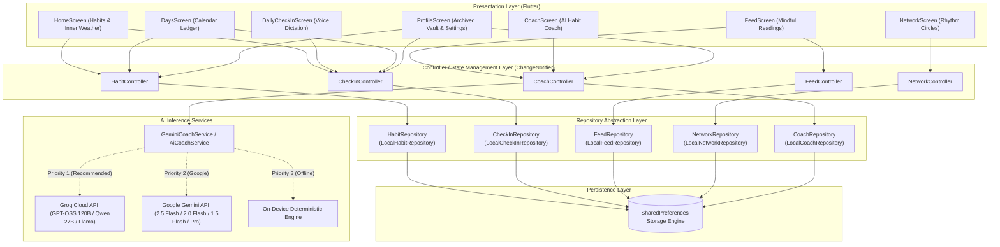

# Tend — Project Architecture & Feature Documentation

> **Tend** is a mindful daily rhythm, focus, and productivity application rooted in Japanese wabi-sabi principles and Scandinavian functionalism. It prioritizes deliberate attention, gentle consistency, and sustainable rhythms over metric exploitation.

---

## 1. Architectural Overview

Tend is engineered following Clean Architecture principles, ensuring clear separation of concerns, testability, and decoupling between user interfaces, state management, and persistence backends.



### Layer Responsibilities
* **Domain Models (`lib/models/`):** Pure Dart classes defining data structures, validation invariants, and JSON serialization. Decouples specifications from state history.
* **Repository Abstraction (`lib/repositories/`):** Defines abstract contracts for every domain. Concrete `Local*` implementations store state using `SharedPreferences`, enabling drop-in replacement with cloud databases without modifying presentation or controller logic.
* **Controllers (`lib/controllers/`):** Encapsulates mutations, business algorithms (unbroken streak calculation, 7-day affective weather aggregation, circle adherence metrics), and validation.
* **AI Engine & Services (`lib/services/`):** Multi-provider AI service supporting Groq (Llama 3.3 70B), Google Gemini (1.5 Flash / 2.0 Flash), and on-device deterministic heuristics.
* **Presentation Layer (`lib/screens/`, `lib/widgets/`):** Strictly separated UI views observing controllers, adhering to Tend's warm caramel and espresso design tokens.

---

## 2. Domain Models

### 2.1 `Habit`
Defines a rhythm's configuration, recurrence rules, and visual properties.

| Field | Type | Description | Nullable |
| :--- | :--- | :--- | :--- |
| `id` | `String` | Unique habit identifier (e.g., `h_1710928347120`) | No |
| `title` | `String` | Title of the habit (e.g., "Morning stillness") | No |
| `description` | `String?` | Optional intention or contextual note | Yes |
| `frequencyType` | `HabitFrequencyType` | Recurrence type (`daily` or `weekdays`) | No |
| `targetWeekdays` | `List<int>` | Scheduled weekdays (1 = Monday, ..., 7 = Sunday) | No |
| `colorHex` | `String` | Accent color hex (default: `#744127`) | No |
| `isArchived` | `bool` | Soft-deletion flag preserving historical logs | No |
| `createdAt` | `DateTime` | Timestamp of habit creation | No |
| `archivedAt` | `DateTime?` | Timestamp when habit was archived | Yes |

### 2.2 `HabitCompletion`
Tracks a discrete completion event on a calendar day.

| Field | Type | Description | Nullable |
| :--- | :--- | :--- | :--- |
| `id` | `String` | Unique completion ID (`{habitId}_{dateKey}`) | No |
| `habitId` | `String` | Foreign key referencing `Habit.id` | No |
| `dateKey` | `String` | ISO calendar date string (`YYYY-MM-DD`) | No |
| `completedAt` | `DateTime` | Exact timestamp when marked complete | No |

### 2.3 `MoodEnergyCheckIn`
Represents a daily state log capturing affective valence (mood), vitality (energy), contextual tags, and reflective notes.

| Field | Type | Description | Nullable |
| :--- | :--- | :--- | :--- |
| `id` | `String` | Unique check-in identifier | No |
| `dateKey` | `String` | Normalized calendar date string (`YYYY-MM-DD`) | No |
| `createdAt` | `DateTime` | Capture timestamp | No |
| `moodScore` | `int` | Discrete mood scale rating (1 to 5) | No |
| `energyScore` | `int` | Discrete vitality scale rating (1 to 5) | No |
| `tags` | `List<String>` | Mindful context tags (`#Stillness`, `#Nature`, `#Sleep`) | No |
| `note` | `String` | User reflection or voice-dictated journal entry | No |

### 2.4 `CoachMessage`, `CoachAction` & `CoachSession`
Represents conversations, suggested actions, and multi-session persistence for the AI Habit Coach.

#### `CoachSession` Model
| Field | Type | Description | Nullable |
| :--- | :--- | :--- | :--- |
| `id` | `String` | Unique conversation identifier (e.g., `session_1732155128000_0`) | No |
| `title` | `String` | Session title, auto-generated from prompt or user-edited | No |
| `createdAt` | `DateTime` | Session creation timestamp | No |
| `updatedAt` | `DateTime` | Last activity or message timestamp | No |
| `isPinned` | `bool` | Whether pinned to top of conversation list | No |
| `isArchived` | `bool` | Whether moved to archived conversations | No |
| `messages` | `List<CoachMessage>`| Ordered sequence of messages in this session | No |

#### `CoachMessage` Model
| Field | Type | Description | Nullable |
| :--- | :--- | :--- | :--- |
| `id` | `String` | Unique message identifier | No |
| `sender` | `CoachSender` | Message author (`user` or `coach`) | No |
| `text` | `String` | Conversational coaching text | No |
| `timestamp` | `DateTime` | Timestamp of message dispatch | No |
| `action` | `CoachAction?` | AI-suggested habit change requiring confirmation | Yes |
| `metricsSummary` | `Map<String, dynamic>?` | Weekly adherence rate and observation highlights | Yes |

#### `CoachAction` Schema
* `id` (`String`): Action identifier.
* `type` (`CoachActionType`): `createHabit`, `modifyHabit`, or `none`.
* `targetHabitId` (`String?`): Existing habit ID for modifications.
* `title` (`String`): Proposed rhythm name.
* `description` (`String?`): Proposed intention.
* `frequencyType` (`HabitFrequencyType`): Daily or weekday recurrence.
* `targetWeekdays` (`List<int>`): Target active days.
* `colorHex` (`String`): Color code.
* `reason` (`String`): Grounded explanation derived from habit context.
* `isExecuted` (`bool`): Whether accepted and executed.
* `isDismissed` (`bool`): Whether rejected by user.

### 2.5 `FeedArticle`
Represents curated mindful essays on stillness, ergonomics, circadian resets, and habit recovery.

| Field | Type | Description | Nullable |
| :--- | :--- | :--- | :--- |
| `id` | `String` | Unique article identifier | No |
| `title` | `String` | Article headline | No |
| `excerpt` | `String` | Brief contemplative summary | No |
| `content` | `String` | Complete essay markdown/prose | No |
| `author` | `String` | Author name | No |
| `authorRole` | `String` | Professional title or focus | No |
| `category` | `String` | Tag (`Stillness`, `Rhythm`, `Focus`, `Rest`) | No |
| `readTimeMinutes` | `int` | Estimated reading duration in minutes | No |
| `publishedAt` | `DateTime` | Publication date | No |
| `isBookmarked` | `bool` | User save state | No |

### 2.6 `RhythmCircle` & `CircleMember`
Represents quiet peer accountability sanctuaries focused on shared intentions.

| Field | Type | Description | Nullable |
| :--- | :--- | :--- | :--- |
| `id` | `String` | Unique circle identifier | No |
| `name` | `String` | Circle title (e.g., "Dawn Walkers") | No |
| `philosophy` | `String` | Guiding ethos or intention | No |
| `category` | `String` | Category (`Morning`, `Focus`, `Rest`, `Creative`) | No |
| `rhythmFocus` | `String` | Core rhythm goal | No |
| `memberCount` | `int` | Number of active companions | No |
| `weeklyConsistencyPercent` | `int` | Collective weekly adherence rate (0-100%) | No |
| `isJoined` | `bool` | Whether the current user is a member | No |
| `members` | `List<CircleMember>` | Sample peer presence profiles | No |
| `createdAt` | `DateTime` | Creation date | No |

---

## 3. Business Logic & Algorithms

### 3.1 Unbroken Streak Calculation
```dart
int getStreakForHabit(String habitId) {
  final today = DateTime.now();
  final todayClean = DateTime(today.year, today.month, today.day);
  int streak = 0;
  DateTime checkDate = todayClean;

  final isScheduledToday = habit.isScheduledFor(checkDate);
  final isDoneToday = isHabitCompleted(habitId, checkDate);

  if (isScheduledToday && isDoneToday) {
    streak++;
    checkDate = checkDate.subtract(const Duration(days: 1));
  } else {
    checkDate = checkDate.subtract(const Duration(days: 1));
  }

  while (true) {
    if (habit.isScheduledFor(checkDate)) {
      if (isHabitCompleted(habitId, checkDate)) {
        streak++;
        checkDate = checkDate.subtract(const Duration(days: 1));
      } else {
        break; // Streak broken on missed scheduled day
      }
    } else {
      // Non-scheduled day (e.g. weekend on weekday rhythm) does not break streak
      checkDate = checkDate.subtract(const Duration(days: 1));
    }
  }
  return streak;
}
```

### 3.2 Robust Markdown-Fenced JSON Parser
Many LLMs wrap valid JSON in markdown blocks (` ```json ... ``` `). Tend includes a dedicated cleaning and regex-free boundary parser:
```dart
static Map<String, dynamic>? cleanAndParseJson(String raw) {
  String clean = raw.trim();
  if (clean.startsWith('```json')) {
    clean = clean.substring(7);
  } else if (clean.startsWith('```')) {
    clean = clean.substring(3);
  }
  if (clean.endsWith('```')) {
    clean = clean.substring(0, clean.length - 3);
  }
  clean = clean.trim();

  final firstBrace = clean.indexOf('{');
  final lastBrace = clean.lastIndexOf('}');
  if (firstBrace != -1 && lastBrace != -1 && lastBrace >= firstBrace) {
    clean = clean.substring(firstBrace, lastBrace + 1);
  }

  try {
    return jsonDecode(clean) as Map<String, dynamic>;
  } catch (e) {
    return null;
  }
}
```

### 3.3 Multi-Provider AI Engine Cascade
When the user consults the coach:
1. **Tier 1 — Groq Cloud API (Recommended):** Calls Groq's high-throughput OpenAI-compatible endpoint using `llama-3.3-70b-versatile` with automatic fallback to `llama-3.1-8b-instant`. Returns sub-second responses with zero setup friction.
2. **Tier 2 — Google Gemini API:** Connects via REST to Google Gemini with automatic model sequencing (`gemini-1.5-flash` $\rightarrow$ `gemini-2.0-flash` $\rightarrow$ `gemini-1.5-pro`) to eliminate model mismatch errors across different project tiers.
3. **Tier 3 — On-Device Deterministic Engine:** If neither key is present or offline, the local engine computes completion rates, streak stability, and mood-energy friction vectors, generating structured advice and action proposals deterministically.

---

## 4. Proposed REST API Contracts

### 4.1 Groq Chat Completions API
* **Endpoint:** `POST https://api.groq.com/openai/v1/chat/completions`
* **Headers:** `Authorization: Bearer <GROQ_API_KEY>`, `Content-Type: application/json`
* **Request Payload:**
```json
{
  "model": "openai/gpt-oss-120b",
  "messages": [
    {
      "role": "system",
      "content": "You are Tend's AI Habit Coach..."
    },
    {
      "role": "user",
      "content": "User Question: \"How consistent was I this week?\"\nUser Context: { ... }"
    }
  ],
  "response_format": { "type": "json_object" },
  "temperature": 0.3
}
```
* **Response Payload (200 OK):**
```json
{
  "choices": [
    {
      "message": {
        "content": "{\n  \"message\": \"Your weekly rhythm consistency stands at 80%...\",\n  \"weekly_summary\": { \"completion_rate\": \"80%\" },\n  \"suggested_action\": { \"type\": \"create_habit\", \"title\": \"Evening pause\" }\n}"
      }
    }
  ]
}
```

### 4.2 Google Gemini Generate Content API
* **Endpoint:** `POST https://generativelanguage.googleapis.com/v1beta/models/gemini-1.5-flash:generateContent?key=<GEMINI_KEY>`
* **Headers:** `Content-Type: application/json`, `x-goog-api-key: <GEMINI_KEY>`
* **Request Payload:**
```json
{
  "contents": [
    {
      "parts": [{ "text": "System prompt and user habit context..." }]
    }
  ],
  "generationConfig": {
    "responseMimeType": "application/json",
    "temperature": 0.3
  }
}
```

### 4.3 Habit Management Endpoints
* `GET /api/v1/habits`: Retrieves all active and archived habits.
* `POST /api/v1/habits`: Creates a new habit entity.
* `PUT /api/v1/habits/:id`: Updates habit configuration.
* `POST /api/v1/habits/:id/toggle`: Marks a habit complete or incomplete for a specific date.
* `POST /api/v1/habits/:id/archive`: Soft-deletes a habit to the profile vault.

### 4.4 Inner Weather Check-in Endpoints
* `GET /api/v1/checkins`: Returns historical mood and energy logs.
* `POST /api/v1/checkins`: Logs a daily check-in with mood score, energy score, tags, and reflection note.
* `DELETE /api/v1/checkins/:id`: Deletes a specific reflection entry.

### 4.5 Feed & Network Endpoints
* `GET /api/v1/feed/articles?category=:cat&query=:q`: Retrieves articles with category and search filtering.
* `POST /api/v1/feed/articles/:id/bookmark`: Toggles saved state for an essay.
* `GET /api/v1/circles`: Retrieves rhythm circles and active peer presence counts.
* `POST /api/v1/circles/:id/join`: Joins a rhythm circle.
* `POST /api/v1/circles/:id/stillness`: Transmits a non-invasive stillness nod to peers.

---

## 5. Local Persistence Specification

* **Storage Engine:** `SharedPreferences`
* **Keys:**
  * `tend_habits_v1`: Serialized `List<Habit>`.
  * `tend_completions_v1`: Serialized `List<HabitCompletion>`.
  * `tend_check_ins_v1`: Serialized `List<MoodEnergyCheckIn>`.
  * `tend_coach_sessions_v2`: Multi-session persistence `List<CoachSession>`.
  * `tend_coach_messages_v1`: Legacy single-session fallback messages list (auto-migrated to v2).
  * `tend_feed_bookmarks_v1`: Serialized string array of bookmarked article IDs.
  * `tend_circles_v1`: Serialized `List<RhythmCircle>`.
  * `tend_groq_api_key`: Optional Groq API key string.
  * `tend_gemini_api_key`: Optional Google Gemini API key string.
  * `tend_ai_provider`: Active AI provider choice (`auto`, `groq`, `gemini`).

---

## 6. Implementation Status Matrix

| Component / Feature | Architecture Layer | Status | Verification |
| :--- | :--- | :--- | :--- |
| **Habit Tracker & Recurrence** | Model, Repo, Controller, UI | **Implemented** | 9 unit/business logic tests passing |
| **Weekly Progress Ribbon** | Controller, Presentation | **Implemented** | Widget test & date arithmetic verified |
| **Daily Mood & Energy Check-in** | Model, Repo, Controller, UI | **Implemented** | 8 unit tests passing + dictation button |
| **Footer Popping-out Coach Button**| Presentation Widget | **Implemented** | Center navigation opens AI Habit Coach |
| **AI Habit Coach (Chat & Actions)** | Model, Repo, Controller, UI | **Implemented** | 11 coach & parser tests passing |
| **AI Session Management (Save/Pin/Archive/Delete)** | Model, Repo, Controller, UI | **Implemented** | Unit & repository session tests passing |
| **Bottom Model Indicator & Quick Setup** | Presentation Widget, UI | **Implemented** | Bottom chip near input with profile routing |
| **Groq Llama 3.3 70B Integration** | Service, Controller, UI | **Implemented** | Direct client integration + model fallback |
| **Google Gemini Flash / Pro** | Service, Controller, UI | **Implemented** | Direct client integration + model sequence |
| **Mindful Feed (Coming Soon State)**| Presentation Screen | **Implemented** | Clean empty state with wabi-sabi styling |
| **Rhythm Circles (Coming Soon State)**| Presentation Screen | **Implemented** | Clean empty state with wabi-sabi styling |
| **Days Mindful Calendar & Ledger** | Screen, Presentation | **Implemented** | Calendar ledger test passing |
| **Archived Rhythms & Profile Vault**| Screen, Controller | **Implemented** | Verified in ProfileScreen |
| **Reflections Badge Wrap Layout** | Presentation Widget | **Implemented** | `Wrap` layout eliminates pixel overflow |
| **Custom App Launcher Icons** | Assets & Android/iOS Res | **Implemented** | Cropped emblem with adaptive icon support |
| **Remote Sync Cloud Database** | Proposed Backend Architecture | **Proposed** | REST API contracts documented |

---

## 7. Versioning & Changelog

| Version | Date | Changes |
| :--- | :--- | :--- |
| `1.0.0+1` | 2026-11-19 | Initial release with Habit Tracking and Popping-Out Voice Button. |
| `1.1.0+2` | 2026-11-20 | Added Feature #2 Daily Mood & Energy Check-in with speech dictation. |
| `1.2.0+3` | 2026-11-20 | Implemented Feature #3 AI Habit Coach with Gemini API and action cards. |
| `1.3.0+4` | 2026-11-20 | Completed Feed, Network, and Days screens. |
| `1.4.0+5` | 2026-11-20 | Upgraded AI Coach with direct Groq (Llama 3.3 70B) and Google Gemini multi-provider engine; removed Azure Functions proxy; added markdown-fenced JSON stripping. |
| `1.4.1+6` | 2026-11-20 | Fixed Groq API model routing by updating deprecated model IDs to active high-throughput models (GPT-OSS 120B/20B, Qwen 27B) and upgraded Gemini API multi-part candidate text parsing and Gemini 2.5 Flash fallback sequence. |
| `1.4.2+7` | 2026-11-20 | Comprehensive error handling and user notification suite: added human-readable HTTP 401/429/404/500 formatting, network timeout/offline detection, interactive dismissible banner in CoachScreen, and background live key validation in ProfileScreen. |
| `1.5.0+8` | 2026-11-21 | Added full AI conversation session management (save, create, delete, archive, pin to top, rename); relocated model indicator to bottom near text field; wired footer center button to open AI Coach; cleaned header navigation; replaced Feed & Network screens with serene "Coming Soon" states; fixed 1.8px badge overflow in Reflections Journal using adaptive `Wrap`. |
| `1.5.1+9` | 2026-11-21 | Reverted footer center button appearance to pristine wabi-sabi acoustic petal design without overlay icons; fixed button crash by removing recursive repository calls and adding frame-safe callbacks and navigation guards; added dedicated BackButton in CoachScreen; generated bespoke custom app launcher icons from cropped logo emblem with Android adaptive and iOS icon sets. |
